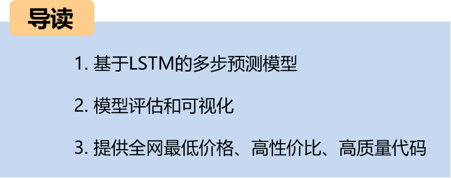
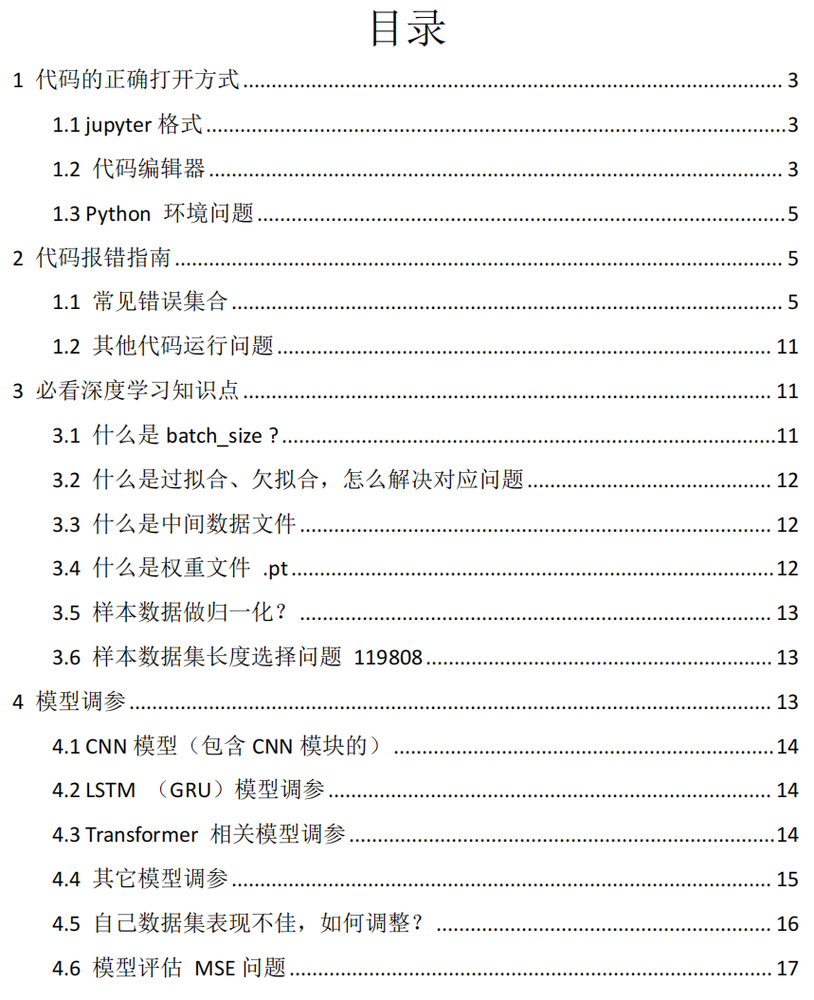
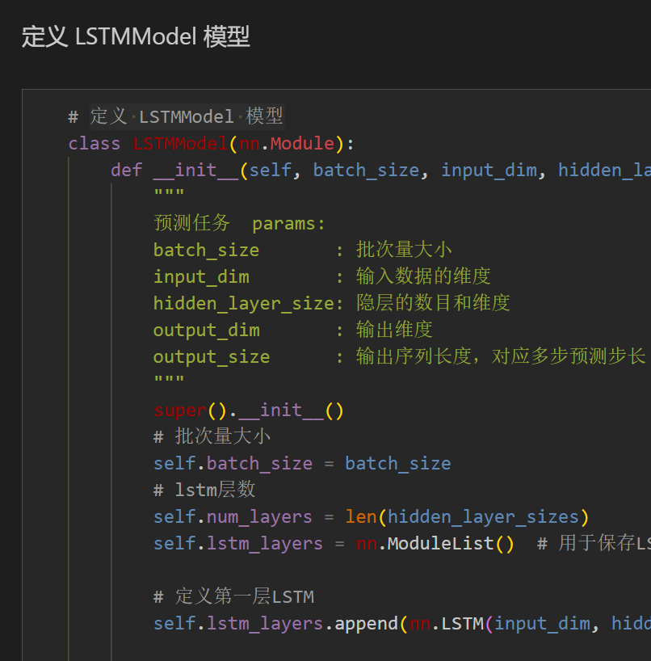
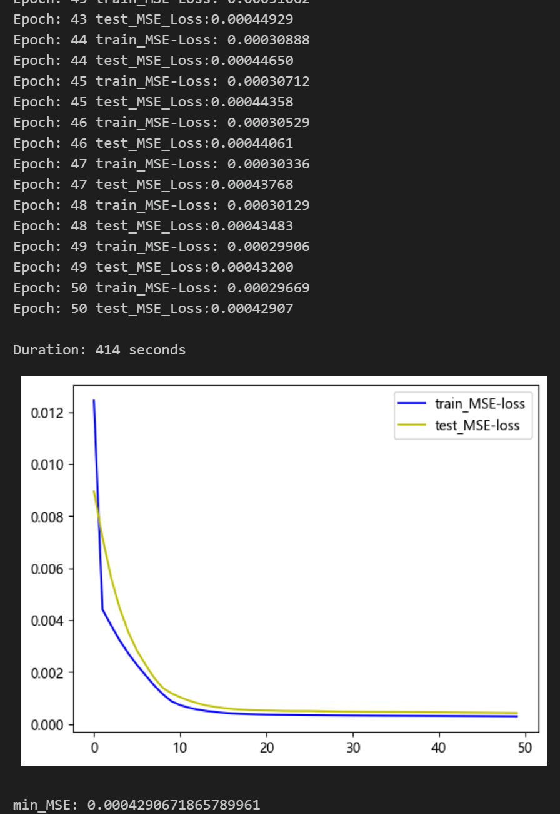
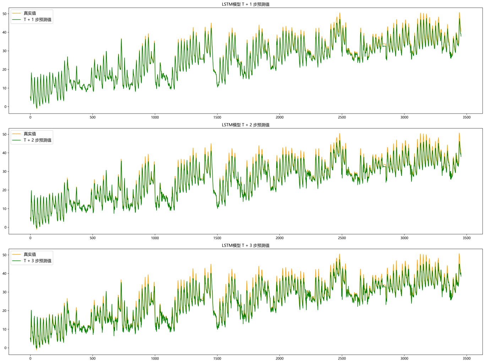
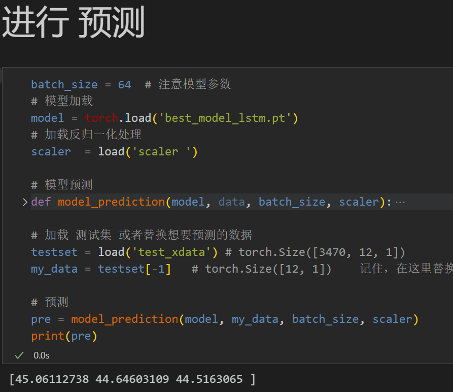
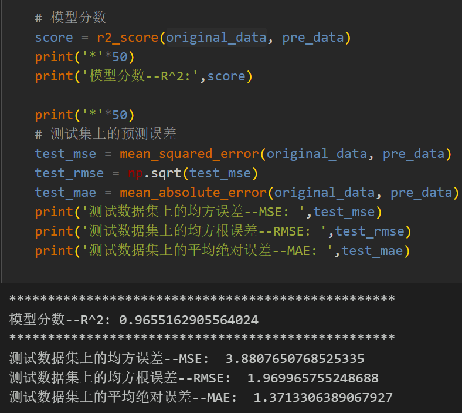
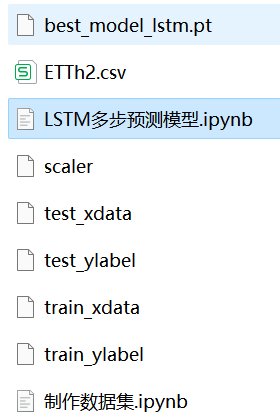

# LSTM Multi-Step Prediction Model

Including complete process data code processing: multi-step prediction dataset creation, data loading, model definition, parameter setting, model training, model testing, prediction visualization, multi-step prediction, model evaluation.
● Environment Framework: Python 3.9, PyTorch 1.8 and above can be run.
● Usage Object: Paper requirements, graduation design requirements.
● Code Guarantee: The code comments are detailed and ready to run.
Code and file introduction:
Preface
This article is based on the previous introduction of power transformers (data set attached at the end). It introduces a multi-step prediction model based on LSTM.
The detailed introduction to the power transformer dataset can be found in the following text:
Introduction to the Power Transformer Dataset and Preprocessing
1 Data Preprocessing and Visualization of Electric Power Transformers
1.1 Import data
1.2 Multi-step Preprocessing for Prediction
2. Multi-step Prediction Model Based on LSTM
2.1 Define the LSTM network model
\t  
2.2 Set parameters and train the model
50 epochs, MSE is 0.000429, the LSTM multi-step prediction model has a significant predictive effect. The model can fully extract the temporal features of the sequence, converges quickly, and performs excellently with high accuracy in predictions. By appropriately adjusting the model parameters, further improvements in the model's predictive performance can be achieved.
\tNote: Adjust parameters.
\tIt is appropriate to increase the number of LSTM layers and the dimensions per layer, fine-tuning the learning rate.
\tIncrease more epochs (note to prevent overfitting)
\tThe sliding window length can be changed (set the appropriate window length).
3 Results Visualization and Prediction, Model Evaluation
3.1 Visualization of Prediction Results
3.2 Load the model for prediction
3.3 Model Evaluation
Previously Featured Content:
Time Series Forecasting: Analysis and comparison of LSTM, ARIMA, Holt-Winters, SARIMA models
Wind Speed Prediction (I) Data Set Introduction and Preprocessing
Wind Speed Prediction (II) EMD-LSTM Model Based on PyTorch
Wind Speed Prediction (III) EMD-LSTM-Attention Model
Wind Speed Prediction (IV) EMD-Transformer Model Based on PyTorch
Wind Speed Prediction (V) EMD-CNN-LSTM Model Based on PyTorch
Wind Speed Prediction (VI) EMD-CNN-GRU Parallel Model Based on PyTorch
CEEMDAN + Combination Prediction Model (BiLSTM-Attention + ARIMA)
CEEMDAN + Combination Prediction Model (CNN-LSTM + ARIMA)
CEEMDAN + Combination Prediction Model (Transformer - BiLSTM + ARIMA)
CEEMDAN + Combination Prediction Model (CNN-Transformer + ARIMA)
Multi-Feature Variable Sequence Prediction (I) - CNN-LSTM Wind Speed Prediction Model
Multi-Feature Variable Sequence Prediction (II) - CNN-LSTM-Attention Wind Speed Prediction Model
Multi-Feature Variable Sequence Prediction (III) - CNN-Transformer Wind Speed Prediction Model
Multi-Feature Variable Sequence Prediction (IV) Transformer-BiLSTM Wind Speed Prediction Model
Multi-Feature Variable Sequence Prediction (V) CEEMDAN+CNN-LSTM Wind Speed Prediction Model
Multi-Feature Variable Sequence Prediction (VI) CEEMDAN+CNN-Transformer Wind Speed Prediction Model
Prediction Model Based on SSA Optimized by Sparrow: CEEMDAN-BiLSTM-Attention
Prediction Model Based on SSA Optimized by Sparrow: CEEMDAN-Transformer-BiGRU
Superior Prediction Model: Secondary Decomposition-Combination Prediction
Multi-feature variable sequence prediction (7) CEEMDAN+Transformer-BiLSTM prediction model  
Multi-feature variable sequence prediction (8) CEEMDAN-SSA-BiLSTM prediction model based on the Plumage Optimization Algorithm  
Multi-feature variable sequence prediction (11) TCN-GRU prediction model based on Pytorch  
VMD + CEEMDAN secondary decomposition, CNN-LSTM prediction model  
VMD + CEEMDAN secondary decomposition, CNN-Transformer prediction model  
VMD + CEEMDAN secondary decomposition, Transformer-BiGRU prediction model  
Prediction model based on SSA of the Plumage Optimization Algorithm - code all-in-one set  
Introduction to the power transformer dataset and preprocessing  
 | Sci-Tech 1st Class High Innovation Prediction Model!
END  
2. Friends who like this can click to follow, give the article a "like", share in the circle or discuss groups

## Images

<!-- PAYMENT_BLOCK -->

## Get this dataset

- Payment link (Stripe): [Buy now](https://buy.stripe.com/3cs8yP7sY87d0vu9AB)
- Payment QR code: 

<!-- /PAYMENT_BLOCK -->
